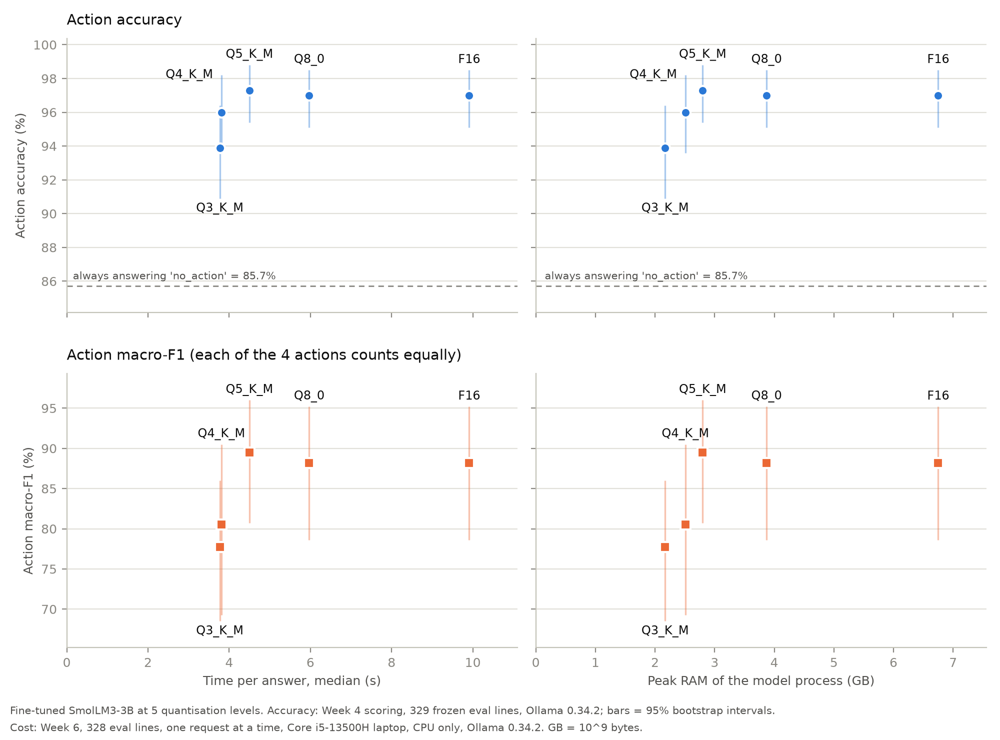
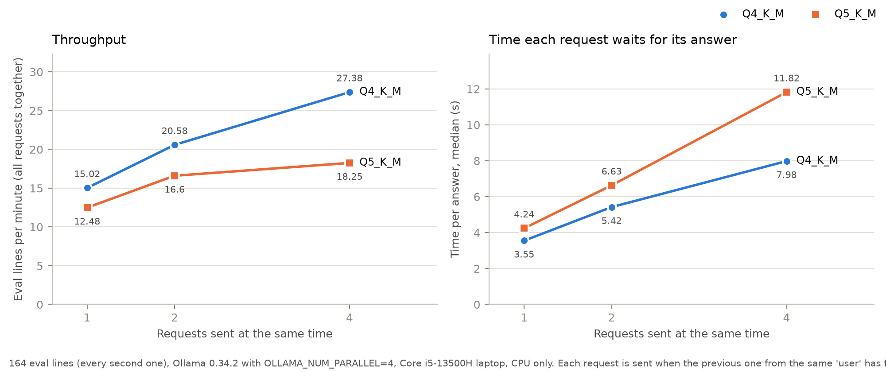

# Log-Triage SLM

A small language model fine-tuned to read a raw log line and return a structured record.

Input:

```
BLOCK* NameSystem.addStoredBlock: blockMap updated: 10.251.74.79:50010 is added to blk_-2827716238972737794 size 67108864
```

Output:

```json
{"service": "dfs.DataNode$DataXceiver", "severity": "INFO", "identifiers": ["-2827716238972737794"], "recommended_action": "no_action"}
```

The question I am actually trying to answer is not whether a 3B model can do this. It is how much accuracy survives when you compress the model to run cheaply, and what each compression level buys you in memory, latency and throughput on ordinary hardware. Measuring that trade-off is the point of the project.

Shubham Alyan, B.Tech Computer Engineering, NIT Kurukshetra.

## Where it stands

Done: the dataset, the frozen evaluation set, the untuned baseline, the fine-tune, the quantisation sweep (five levels, all scored on the frozen set), the serving layer (a FastAPI service in front of Ollama, also packaged with Docker), speed and memory benchmarks for every level, a load test, and the accuracy-against-cost figure. The weights for all five levels and the LoRA adapter are public on Hugging Face: [shubham-alyan24/SmolLM3-3B-logtriage-GGUF](https://huggingface.co/shubham-alyan24/SmolLM3-3B-logtriage-GGUF).

Next: the written report.

## Results

Frozen evaluation set, 329 examples. Every model is served through Ollama 0.34.2, same machine, same prompt, same settings.

### Does fine-tuning work?

Both models at Q8_0:

| Metric | Untuned | Fine-tuned | Always most-common answer |
|---|---|---|---|
| Parsed / schema-valid | 99.1% | 99.7% | - |
| Strict JSON | 0.0% | 99.7% | - |
| Action accuracy | 83.3% | 97.0% | 85.7% |
| Action macro-F1 | 24.3% | 88.2% | 23.1% |
| Severity accuracy | 66.6% | 95.7% | 84.5% |
| Service accuracy | 20.1% | 79.9% | 23.1% |
| Identifier F1 | 29.0% | 92.2% | - |
| Identifiers exactly right | 2.4% | 81.8% | - |
| check_network found | 0/16 | 16/16 | 0/16 |
| escalate_oncall found | 0/6 | 6/6 | 0/6 |

The column that matters is the last one. 86% of the evaluation set is `no_action`, so a model that always answers `no_action` already scores 85.7%, and the untuned model does worse than that. The fine-tuned model beats it on every field, which is the only comparison worth making here.

Ollama updated itself partway through the project (0.32.6 to 0.34.2), so both models were re-scored on the new version. The same inputs changed 262 of 329 untuned outputs but only 13 of 329 fine-tuned ones; no conclusion changed.

Broken down by whether the log pattern appeared in training (fine-tuned, Q8_0):

| | seen patterns (185) | unseen patterns (144) |
|---|---|---|
| Action accuracy | 98.4% | 95.1% |
| Severity accuracy | 97.8% | 93.1% |
| Service accuracy | 95.7% | 59.7% |
| Identifier F1 | 96.8% | 87.9% |

Unseen patterns are the real test. Service falls off a cliff there because the component name never appears in the input text, so for a new pattern the model has nothing to copy and can only guess from wording.

### How much survives compression?

The fine-tuned model at five precision levels:

| Level | Size | Real bits/weight | Action acc | Action macro-F1 | Severity | Service | Identifier F1 | escalate_oncall found (precision) |
|---|---|---|---|---|---|---|---|---|
| F16 | 6.16 GB | 16.02 | 97.0% | 88.2% | 95.7% | 79.9% | 91.9% | 6/6 (0.50) |
| Q8_0 | 3.28 GB | 8.52 | 97.0% | 88.2% | 95.7% | 79.9% | 92.2% | 6/6 (0.50) |
| Q5_K_M | 2.21 GB | 5.76 | 97.3% | 89.5% | 95.7% | 79.9% | 92.0% | 6/6 (0.50) |
| Q4_K_M | 1.92 GB | 4.98 | 96.0% | 80.5% | 95.7% | 79.3% | 91.3% | 3/6 (0.38) |
| Q3_K_M | 1.57 GB | 4.09 | 93.9% | 77.7% | 93.6% | 80.9% | 89.2% | 4/6 (0.27) |

- F16, Q8_0 and Q5_K_M are the same within noise. Q5_K_M is 64% smaller than F16 with no measurable loss. Its slightly higher macro-F1 is one or two lines, so it is not better, just not worse.
- Q4_K_M is where the first damage shows, and it lands on the most critical class: only 3 of 6 `escalate_oncall` lines found. Six lines is too few to prove anything, so this is a warning sign rather than a result.
- Q3_K_M declines across the board. It makes 20 action errors against F16's 10, and all ten extra ones are on BGL logs; severity and identifiers drop too. It is still far above the untuned model.
- Lower levels raise more false alarms: `escalate_oncall` precision falls from 0.50 to 0.27.
- "Real bits/weight" is higher than the name suggests because the shared input/output embedding is kept in a higher 6-bit format (Q6_K) in every K level, so "Q4_K_M" is really about 5 bits per weight.

### What does each level cost?

The same five models, one request at a time, on the same laptop (Core i5-13500H, CPU only):

| Level | File | Peak RAM | First token (median) | Whole answer (median / 95th pct) | Lines per minute | Writing speed | Prompt reading speed |
|---|---|---|---|---|---|---|---|
| Q3_K_M | 1.57 GB | 2.17 GB | 0.96 s | 3.77 / 6.88 s | 14.2 | 18.2 tok/s | 37.1 tok/s |
| Q4_K_M | 1.92 GB | 2.51 GB | 0.63 s | 3.81 / 6.84 s | 14.1 | 16.1 tok/s | 57.0 tok/s |
| Q5_K_M | 2.21 GB | 2.80 GB | 1.11 s | 4.50 / 8.22 s | 11.9 | 14.9 tok/s | 32.2 tok/s |
| Q8_0 | 3.28 GB | 3.87 GB | 1.21 s | 5.97 / 10.79 s | 9.0 | 10.7 tok/s | 29.2 tok/s |
| F16 | 6.16 GB | 6.75 GB | 1.10 s | 9.91 / 17.36 s | 5.5 | 5.8 tok/s | 32.5 tok/s |

- Writing speed is limited by memory bandwidth. Writing speed times file size comes out at about 29-36 GB/s for every level, so a smaller file writes proportionally faster. F16 writes about three times slower than Q3_K_M.
- Prompt reading does not follow file size. Q4_K_M reads prompts at 57 tok/s against 29-37 for the rest, which gives it the fastest first token. On this CPU, llama.cpp rearranges Q4_K weights into a faster layout; it does not do that for Q3_K, Q5_K, Q6_K or Q8_0.
- So Q3_K_M and Q4_K_M take the same time per answer (3.77 vs 3.81 s): Q3_K_M writes faster, Q4_K_M reads faster.
- Peak RAM is the file size plus about 0.6 GB at every level.
- Every one of the 5 x 328 answers was character-for-character identical to the scoring run, so these costs belong to exactly the outputs that were scored.

How it was measured: 328 evaluation lines per level (the one line over 2,000 characters is skipped, as the API rejects it), after three warm-up lines that are not counted, with the exact scoring prompt and settings, streamed so the first token can be timed. Ollama re-uses the shared start of the prompt between requests, its default and also on during scoring. llama.cpp picked 8 threads automatically; they were not tuned. The laptop was on charger in "Best performance" mode with other apps closed. Repeating 30 lines at the end of the session changed the whole-answer time by 0.7% and first-token time by 6.8%, so gaps between levels smaller than that are noise. Full table and conditions: [results/week6_table.md](results/week6_table.md).

### Accuracy against cost



- Every fine-tuned level beats always answering `no_action`. Even Q3_K_M's lowest interval end (90.9%) is above 85.7%.
- Q5_K_M, Q8_0 and F16 are equally accurate. Q8_0 and F16 cost 1.3x and 2.2x the time per answer and 1.4x and 2.4x the peak RAM, and buy nothing for it.
- Below Q5_K_M, Q4_K_M loses 1.3 accuracy points and 9 macro-F1 points, and Q3_K_M loses 3.4 and 12. Both move the same way, but the intervals overlap heavily, because macro-F1 rests on 6 `escalate_oncall` and 16 `check_network` lines. Treat the drop as suggestive, not proven. The intervals are per model, not a paired test of the difference.
- Q3_K_M is not worth it: it takes the same time per answer as Q4_K_M, saves only 0.34 GB of RAM, and scores lower.
- Recommendation: Q5_K_M by default. Q4_K_M when a fast first token matters more (0.63 s instead of 1.11 s, 15% less time per answer, 0.3 GB less RAM), accepting the warning sign on `escalate_oncall`.

The untuned model (83.3% accuracy, 24.3% macro-F1) is left off the figure because it would squash the scale.

### Several requests at once

Q4_K_M and Q5_K_M with Ollama allowed to work on up to four requests together:

| Level | Requests at once | Lines per minute | Whole answer (median / 95th pct) | First token (median) | Peak RAM |
|---|---|---|---|---|---|
| Q4_K_M | 1 | 15.02 | 3.55 / 6.64 s | 0.64 s | 2.79 GB |
| Q4_K_M | 2 | 20.58 | 5.42 / 9.50 s | 0.78 s | 2.95 GB |
| Q4_K_M | 4 | 27.38 | 7.98 / 14.15 s | 0.97 s | 3.24 GB |
| Q5_K_M | 1 | 12.48 | 4.24 / 8.04 s | 1.17 s | 2.92 GB |
| Q5_K_M | 2 | 16.60 | 6.63 / 11.89 s | 1.24 s | 2.94 GB |
| Q5_K_M | 4 | 18.25 | 11.82 / 22.43 s | 1.45 s | 3.36 GB |



- More requests at once means more total work done, but each one waits longer. Q4_K_M gets 37% and 82% more lines per minute at 2 and 4 at once; Q5_K_M gets 33% and 46%.
- Q4_K_M scales better: at 4 at once it does 50% more lines per minute than Q5_K_M and answers in 8.0 s instead of 11.8 s. Why was not measured; the same Q4_K speed-up that helps prompt reading is a likely candidate.
- For Q5_K_M, two at once is the sensible limit on this laptop. Going to four adds 10% throughput, but the median wait goes from 6.6 to 11.8 s.
- Allowing four requests at once costs a single request no measurable speed, only RAM (about 0.4 GB more after loading Q5_K_M).
- Accuracy did not measurably change under load. The answers are not bit-for-bit repeatable, though: 1, 5 and 7 of the 164 changed for Q4_K_M at 1, 2 and 4 at once, and 0, 1 and 2 for Q5_K_M, mostly identifier lists of long lines. llama.cpp documents that batching requests together can change rounding. One Q4_K_M line flipped to a wrong action at 2 and 4 at once, and another flipped to the right one at 4.

How it was measured: Ollama restarted with `OLLAMA_NUM_PARALLEL=4`; 164 evaluation lines (every second line of up to 2,000 characters), the same lines in every run; N simulated users, each sending a line, waiting for the whole answer, then sending the next; a fresh load and N warm-up lines before every run. The accuracy check covers these 164 lines only. Full table and every changed answer: [results/week7_load.md](results/week7_load.md).

## How it works

Data comes from LogHub-2k (HDFS, BGL, OpenStack, Spark): 8,000 lines over 213 patterns. The model sees the message text only. The level and component headers are stripped so they cannot leak into the answer.

Service, severity and identifiers come from LogHub's own annotations. The recommended action is distilled from a larger teacher model, one label per (pattern, severity) group.

The split is by pattern with a fixed seed, so held-out patterns never appear in training, and the evaluation set was frozen and hashed before any training started. For the training set I dropped exact duplicates and capped each `no_action` pattern at 20 examples, since one pattern alone had over 900 lines and would otherwise swamp the rare actions. That turns 5,451 lines into 1,057 training examples.

The model is SmolLM3-3B, fine-tuned with QLoRA on a free Kaggle T4: 4-bit base, LoRA rank 16 on all linear layers, learning rate 2e-4, effective batch 16, three epochs, about half an hour. Loss is computed on the answer tokens only. I picked the checkpoint by dev loss and nothing else; epoch 1 won.

The adapter is merged into the full-precision model and converted to GGUF with a pinned llama.cpp build. F16 and Q8_0 come straight from the converter; the K levels are made from F16 with `llama-quantize`, without an importance matrix.

For scoring, each level is served through Ollama in raw mode at temperature 0 with a fixed seed. Every model ever scored uses the same prompt, settings and machine. Output that will not parse counts as wrong on every field. Confidence intervals are bootstrapped.

The API (`src/serve.py`) sends exactly the prompt, settings and parser that scoring used, so it answers the way the scored model answered. The benchmarks run on the same Ollama on the same machine, so both axes of the accuracy-against-cost figure come from one runtime. The original plan was to serve through llama.cpp directly; I switched to Ollama so the accuracy and cost numbers can't disagree simply because they were measured with different programs.

## Layout

```
src/                   dataset builder, teacher labelling, splitting, freezing, training-set builder,
                       runner (run_ollama.py), scorer (score.py), API (serve.py),
                       benchmark (bench.py), load test (loadtest.py),
                       tables and figures (week6_table.py, week7_figure.py, week7_load_table.py)
notebooks/             Kaggle notebooks: fine-tuning, quantisation, Hugging Face upload
data/                  splits, frozen evaluation set and its hash
results/               predictions and scores for every model, quantisation details,
                       benchmark and load-test results, tables and figures
models/                one Ollama Modelfile per level (weights are not in git)
Dockerfile, docker-compose.yml, .dockerignore    the containerised API
requirements-serve.txt                           what the API needs, nothing else
```

## Running it

Download the GGUF files from [Hugging Face](https://huggingface.co/shubham-alyan24/SmolLM3-3B-logtriage-GGUF) into `models/` and import a level into Ollama, for example Q5_K_M:

```
ollama create smollm3-ft-q5km -f models/Modelfile.q5km
```

Score a model on the frozen set:

```
python src/run_ollama.py --model smollm3-ft-q5km --tag ft_q5km
python src/score.py results/preds_eval_ft_q5km.jsonl
```

Run the API (Ollama must be running), then open http://127.0.0.1:8000/docs:

```
pip install -r requirements-serve.txt
uvicorn serve:app --app-dir src --port 8000
```

`POST /triage` takes `{"log": "<one log line>"}` and returns the structured record, the model's raw output and its timings. `GET /health` reports the Ollama version and whether the model is loaded. The model can be changed with the `MODEL` environment variable. The API talks to Ollama at `127.0.0.1` rather than `localhost`: on Windows, `localhost` is tried as IPv6 first, Ollama only listens on IPv4, and the failed attempt costs about 2 seconds per request.

Or run everything in Docker (Ollama 0.34.2 and the API), then open http://localhost:8080:

```
docker compose up -d --build
docker compose exec ollama ollama create smollm3-ft-q5km -f /models/Modelfile.q5km
```

The model import is needed once; it stays in a Docker volume after `docker compose down`. The Docker setup is for demonstration. Every number in this README comes from the native setup.

The demo runs on a local machine, natively or in Docker. There is no hosted version: the free plans checked either have too little memory (Render's free tier has 512 MB) or need a paid account to run a model on CPU (Hugging Face Spaces).

Benchmark one level, then rebuild the table and the figure:

```
python src/bench.py --level q5km
python src/week6_table.py
python src/week7_figure.py
```

Load test (restart Ollama with the environment variable `OLLAMA_NUM_PARALLEL=4` first):

```
python src/loadtest.py --level q4km --concurrency 2
python src/week7_load_table.py
```

`bench.py` and `loadtest.py` were written for this Windows laptop. They check the machine before running (Ollama version, Docker closed, charger connected, power mode, free RAM) and refuse to run if anything is off.

## Limits worth knowing

Service is a memorisation task. The component name is not in the input, so 59.7% on unseen patterns is roughly the ceiling of the setup, not something more training fixes.

`escalate_oncall` has six lines in the evaluation set and only 11 distinct lines in training. All six were found at F16, Q8_0 and Q5_K_M, but precision is 0.50 and falls further at lower levels. That class is anecdotal and should be read that way. Every `check_network` training example comes from HDFS, so that action has never been learned from the other systems.

LogHub-2k limits how large the evaluation set can be. It has many duplicate lines, and 120 of the 213 patterns contain only one distinct message.

One evaluation line is unscorable because its correct answer is longer than the output limit. It counts as wrong for every model, including the baseline.

The action labels come from a teacher model, and the evaluation labels were reviewed by an AI assistant, not checked by hand. The ceiling is that model's judgement rather than an expert's. Serving runs on CPU, which caps throughput, and every timing comes from one fixed machine, so the numbers are comparable to each other and to nothing else.

The speed numbers are for a model that is already loaded, with Ollama re-using the shared start of the prompt, as it does by default. Threads were left at llama.cpp's automatic choice and not tuned. Peak RAM includes a growth of about 0.34 GB during each run whose cause was not confirmed. Only Q4_K_M and Q5_K_M were load-tested, on half of the evaluation set, and under load the answers are not bit-for-bit repeatable.

## Next

The written report.

Beyond the project itself, a few things would make the result stronger. Training on more log sources would show whether accuracy on unseen formats actually improves instead of only being measured. Having an expert relabel a sample of the actions would show how far the teacher model's labels sit from real judgement. And comparing against something cheap and non-neural, like nearest-neighbour pattern matching, would show how much the language model is really adding.
